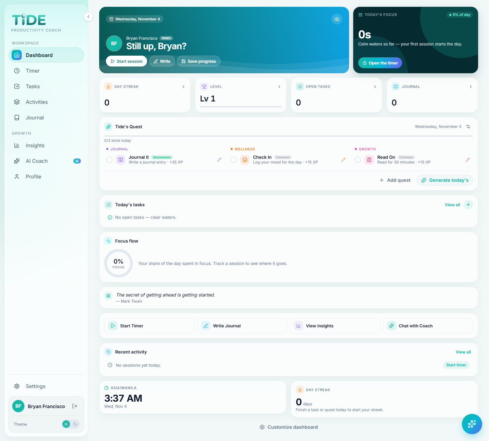
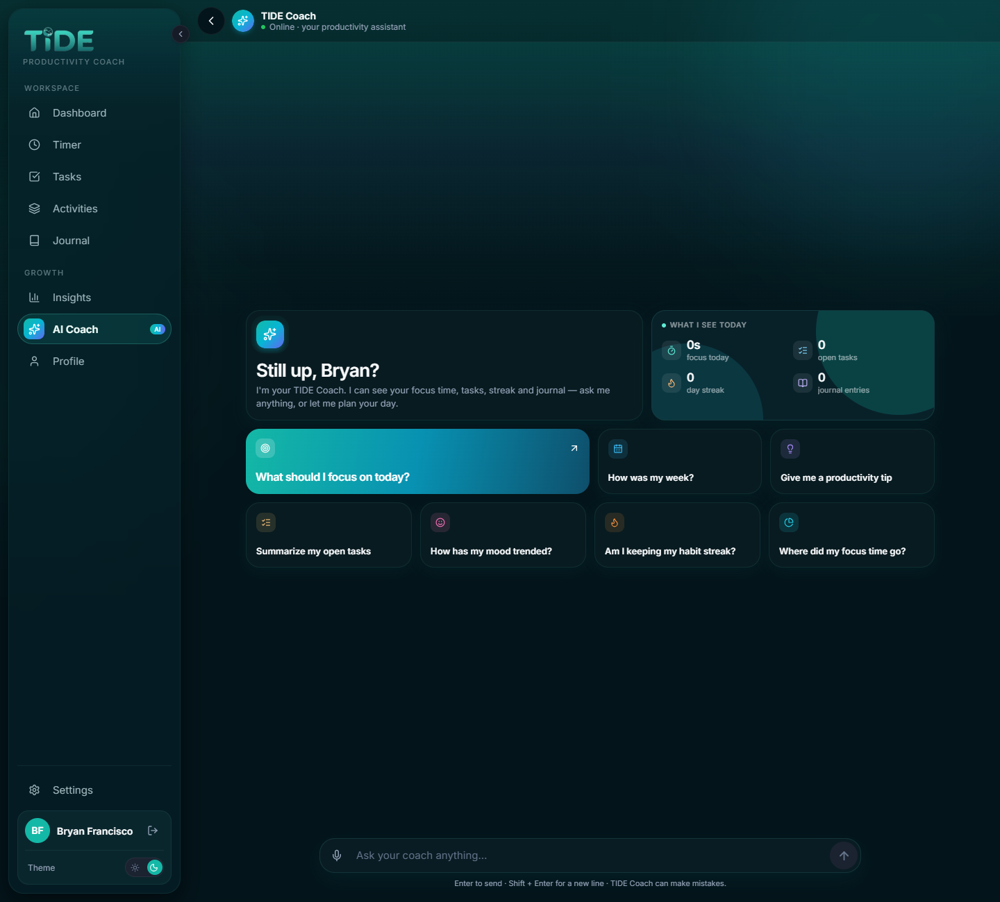
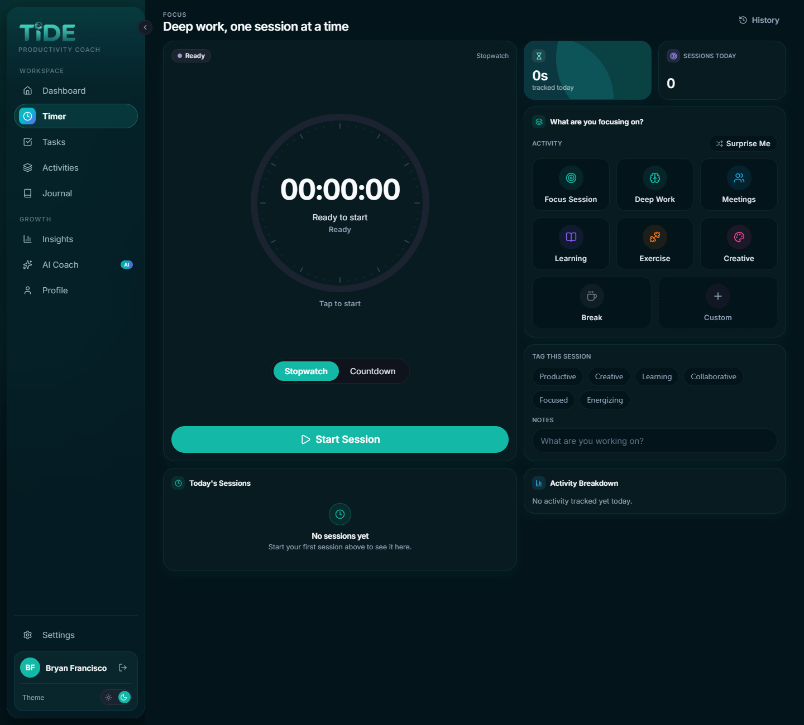
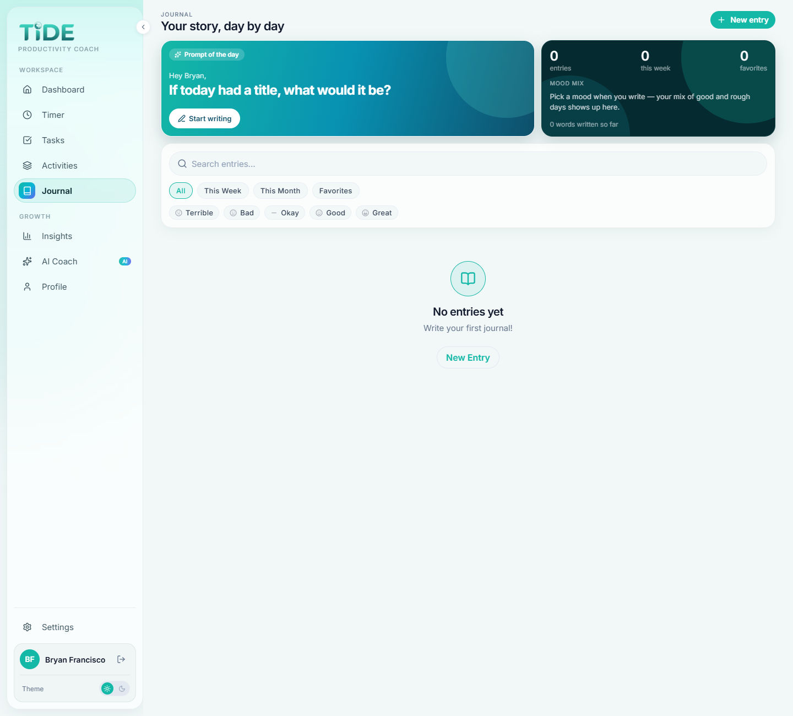
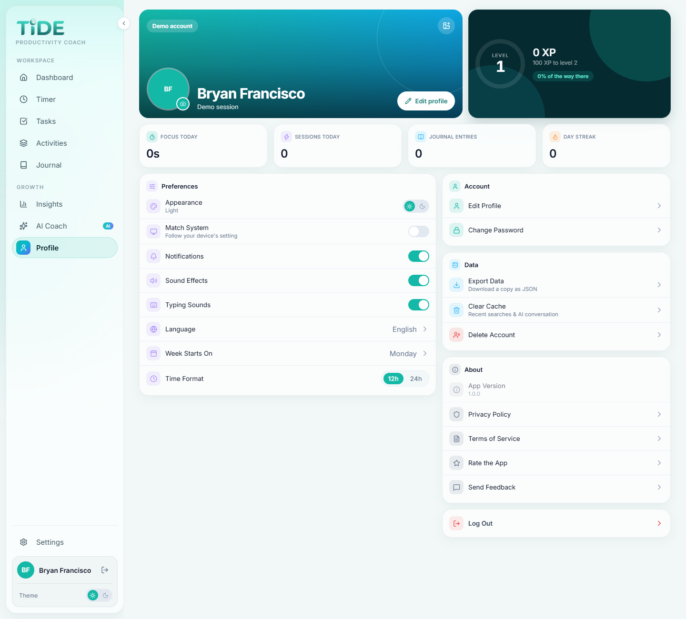
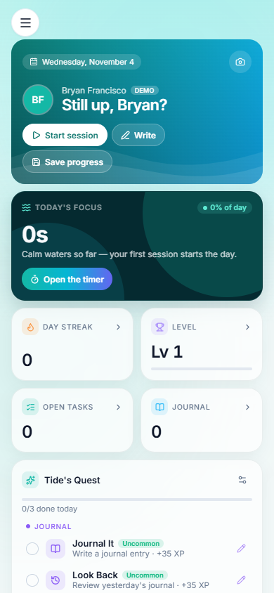
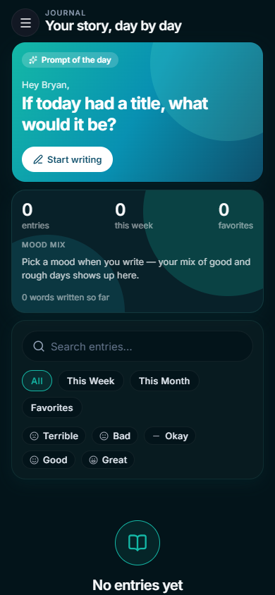

<div align="center">

# 🌊 TIDE

### A server-authoritative, AI-powered productivity OS.

Focus sessions, journaling, tasks and quests, tied together by an AI Coach that reads your real data and can act on it.

[](https://github.com/BryxCinco/tide/actions/workflows/ci.yml)
[](https://github.com/BryxCinco/tide/releases)


**[Live app](https://tide-rust.vercel.app)** · **[API health](https://tide-api-rust.vercel.app/api/health)** · **[Releases](https://github.com/BryxCinco/tide/releases)**



</div>

---

## Why TIDE

Most productivity apps are a set of separate lists: a timer here, a journal there, a to-do app somewhere else, and nothing that sees all of it at once. In TIDE, everything you track goes into one place, and an **AI Coach that can actually see your history** works on top of it. It answers questions about your week, plans your day, and creates or completes tasks for you.

Under the UI, TIDE is built like a production backend. **The server owns every number that matters.** XP, levels, streaks and quest rewards are computed and written server-side with atomic database operations, and the database refuses direct client writes.

## ✨ Features

| | |
| --- | --- |
| ⏱️ **Focus timer** | Stopwatch and countdown sessions against built-in or custom activities. "Surprise Me" leans toward activities you've neglected. |
| 📓 **Mood journal** | Daily prompts, mood tracking, tags, photos, search, and on-demand AI reflection. |
| ✅ **Tasks & quests** | Priorities, due dates, overdue tracking, plus daily **Tide's Quests** with tiered XP rewards. |
| 🏆 **Levels & streaks** | XP for sessions, tasks, journaling and quests, plus day streaks and level-ups. All of it is awarded on the server. |
| 📊 **Insights** | Productivity score, mood trend, activity heatmap and task stats computed from your real data, plus AI suggestions based on the same numbers. |
| 🤖 **AI Coach** | RAG over your own history (pgvector) plus **25 agentic tools**: create, complete or reschedule tasks, log mood, suggest quests, reflect on entries, and more. |
| 🌍 **13 languages** | en, fil, es, ja, zh, ar, ru, ko, id, fr, de, tr, it |
| 🌗 **Light & dark** | Google sign-in, email/password, and a local-only guest mode. |

## 🎨 Design: "Tide Ocean"

v1.1.0 brings a full visual redesign inspired by iOS widgets and the ocean. It looks clean and expensive, in the same family as Linear, Vercel and Raycast, but in TIDE's own teal.

- **Glassmorphism.** Translucent, blurred surfaces float over a living ocean backdrop: light coming down from the surface in light mode, the abyss in dark mode.
- **Bento grid.** Each screen is a dense, responsive grid of tiles. There are three tile tones: **glass** for everyday content, **deep-sea** for the one statement tile per screen, and **lagoon** gradients for hero moments.
- **One palette.** Lagoon, seafoam, aqua, surf, coral, sand and lavender, with teal dominant across every screen, the sidebar, the drawer and the mobile tab bar.
- **Dense by design.** iOS-widget spacing and a tight type scale. Empty and error states shrink automatically when they're inside a compact tile.
- **Calm motion.** Content fades in and never slides or jumps into place.

<table>
  <tr>
    <td width="50%"><p align="center"><b>AI Coach</b></p></td>
    <td width="50%"><p align="center"><b>Focus timer (dark)</b></p></td>
  </tr>
  <tr>
    <td width="50%"><p align="center"><b>Journal</b></p></td>
    <td width="50%"><p align="center"><b>Profile & settings</b></p></td>
  </tr>
</table>

<p align="center">
  
  &nbsp;&nbsp;
  
</p>

## 🔐 Security & Architecture

TIDE treats the client as untrusted. Every rule that protects game state or user data is enforced **on the server and in the database**, and each fix is backed by a regression test.

```
┌──────────────────────┐   HTTPS + Supabase JWT   ┌──────────────────────────────┐   service role   ┌───────────────────────────┐
│ Expo app             │ ───────────────────────► │ Express API (Vercel)         │ ───────────────► │ Supabase Postgres         │
│ iOS / Android / Web  │                          │ helmet · CORS allow-list     │                  │ RLS: read-only for clients│
│ Zustand · NativeWind │ ◄─────────────────────── │ rate limits · auth middleware│ ◄─────────────── │ award_xp() RPC · pgvector │
└──────────────────────┘     computed results     │ XP / quest / streak logic    │                  └───────────────────────────┘
                                                  │ AI Coach (Groq) + local      │
                                                  │ embeddings (MiniLM)          │
                                                  └──────────────────────────────┘
```

### Server-authoritative XP

- **The client never sends XP.** Quest rewards are computed from server-side tier and difficulty tables. Session durations are capped at 12 hours, and timestamps from the future are rejected.
- **Atomic awards.** XP goes through a single Postgres function, `award_xp()`, that adds to the total and recomputes the level in one statement, so concurrent requests can't lose updates. `EXECUTE` is revoked from `anon` and `authenticated`, so only the server can call it.
- **Exactly-once completion.** Completing a task or quest is a conditional update (`… WHERE is_completed IS NOT TRUE`). If you double-tap or race two requests, XP is paid exactly once.
- **The AI can't mint XP.** The Coach's "start a timer" tool returns a navigation instruction instead of writing a session, so XP is only earned for time actually tracked.

### Database lockdown (RLS)

- The original "users can CRUD their own rows" policies would have let any signed-in user write straight to the database with the public anon key, bypassing every server rule. Migrations [`015`](server/migrations/015_drop_levels_policy.sql)–[`017`](server/migrations/017_drop_all_unsafe_policies.sql) **drop every client-side write policy** in the `public` schema. Clients keep read access to their own rows, and all writes go through the API.
- Migration 017 has a built-in guard: it aborts if any unexpected write policy remains, so the database can't silently drift from this rule.

### Ownership & abuse protection

- **Ownership-checked storage.** File deletes go through an ownership check, so one user can never delete another user's journal photos or avatar.
- **Rate limits** (`express-rate-limit`), behind Vercel's proxy:

  | Scope | Limit |
  | --- | --- |
  | Global, per IP | 1000 requests / 15 min |
  | Login, per IP | 5 **failed** attempts / 15 min |
  | Signup, per IP | 20 / hour |
  | Password change, per user | 5 failed attempts / 15 min |
  | AI Coach, per user | 20 messages / min |
  | Insights, per user | 60 requests / min |

- **`helmet`** security headers, a CORS allow-list, and JWT verification via Supabase `getClaims()`.

### Tested and enforced in CI

**57 tests** across 6 suites (Jest + Supertest) run against an in-memory Supabase fake that simulates real concurrency (async interleaving), so race conditions are reproduced instead of assumed:

| Suite | What it proves |
| --- | --- |
| `A-client-controlled-xp` | XP can't be set or inflated by the client |
| `A2-ai-timer-no-early-xp` | The AI Coach can't award XP for time that hasn't been tracked |
| `B-cross-user-file-deletion` | Users can't delete each other's files |
| `C-quest-completion-race` | Concurrent completions pay out exactly once |
| `D-atomic-xp` | Concurrent XP awards never lose an update |
| `rate-limit-and-headers` | Every limiter triggers as configured, and the security headers are present |

GitHub Actions runs **server tests** and a **strict client typecheck** on every push and pull request to `main`. For each bug's root cause, fix and test, see [`docs/security-fixes.md`](docs/security-fixes.md).

## 🧱 Tech Stack

| Layer | Tech |
| --- | --- |
| **App** | Expo (React Native + Web), Expo Router, TypeScript, NativeWind, Zustand, React Hook Form + Zod, Reanimated |
| **API** | Node.js, Express 5, helmet, express-rate-limit, deployed as a Vercel serverless function |
| **Data** | Supabase: Postgres, Auth (email + Google OAuth), Storage, pgvector |
| **AI** | Groq (`qwen/qwen3.8-27b`) for chat and tool-calling; `all-MiniLM-L6-v2` embeddings running locally via `@xenova/transformers` |
| **Quality** | Jest + Supertest, `tsc --noEmit`, GitHub Actions |

## 🚀 Running Locally

**Prerequisites:** Node.js 20+, a [Supabase](https://supabase.com) project, and a [Groq](https://console.groq.com) API key.

### 1. Database

In your Supabase project's **SQL Editor**, run the files in [`server/migrations/`](server/migrations) in numeric order. They aren't applied automatically.

### 2. Backend (API)

```bash
cd server
npm install
cp .env.example .env     # fill in the values below
npm run dev              # http://localhost:5000  (or: npm start)
npm test                 # 57 tests
```

| Variable | Required | Purpose |
| --- | --- | --- |
| `SUPABASE_URL` | ✅ | Supabase project URL |
| `SUPABASE_ANON_KEY` | ✅ | Supabase anon (public) key |
| `SUPABASE_SERVICE_KEY` | ✅ | Service-role key, used by the server only. **Never expose it to the client.** |
| `GROQ_API_KEY` | ✅ | Powers the AI Coach and the Insights suggestions |
| `ALLOWED_ORIGINS` | | Extra CORS origins, comma-separated |
| `PORT` | | Defaults to `5000` |
| `NODE_ENV` | | `production` on Vercel; this also disables the debug routes |

### 3. Frontend (app)

```bash
cd client
npm install
cp .env.example .env     # fill in the values below
npm run web              # web at http://localhost:8081
# npm start              # Expo dev server for iOS / Android
```

| Variable | Required | Purpose |
| --- | --- | --- |
| `EXPO_PUBLIC_API_URL` | ✅ | The API's base URL, e.g. `http://localhost:5000` |
| `EXPO_PUBLIC_SUPABASE_URL` | ✅ | Same Supabase project URL (used for Google OAuth) |
| `EXPO_PUBLIC_SUPABASE_ANON_KEY` | ✅ | Supabase anon key |

> **No backend handy?** Choose **Continue as guest** on the sign-in screen to explore the UI with local-only data. Server-backed screens like Insights need the API running.

## ☁️ Deployment

- **App:** Vercel, serving the Expo web export of `client/`.
- **API:** a Vercel serverless function. `server/api/index.js` wraps the Express app, and `server/vercel.json` routes every request through it.
- Environment variables are set in each Vercel project's dashboard. A variable only applies to deployments created **after** it was saved, so redeploy after adding one.

## 🗺️ Known Limitations

- **Native blur.** The glass effect uses CSS `backdrop-filter`, which only exists on web. iOS and Android show a solid, ocean-tinted surface instead (`expo-blur` would close the gap).
- **Bundle size.** The web bundle is about 12 MB. Most of that is Inter font weights that never load; switching to per-weight font packages would recover most of it.
- **Mock widget.** The dashboard's "Weekly Progress" widget still reads mock data.
- **Base schema.** The tables that predate `server/migrations/` (`activities`, `tasks`, …) don't have a migration file for their base schema.
- **Legacy scaffold.** `client-old/` (a pre-Expo scaffold) is still in the repo.

## 📄 License

No license has been chosen yet. Add one (e.g. MIT) before distributing.

<div align="center">
<sub>Built with 🌊 by <a href="https://github.com/BryxCinco">BryxCinco</a></sub>
</div>
